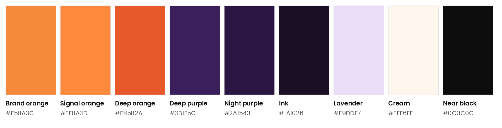

# Netrovert brand kit

Logos, colours, fonts and Gojo the fox, in one place, for NetrovertHQ and Netro Signal.

## Colours

| Name | Hex | Use |
|---|---|---|
| Brand orange | `#F58A3C` | Main brand colour |
| Signal orange | `#FF8A3D` | Netro Signal cards and headlines |
| Deep orange | `#E8582A` | Accents and buttons on netroverthq.com |
| Deep purple | `#3B1F5C` | Gojo's purple, secondary brand colour |
| Night purple | `#2A1543` | Dark purple backgrounds |
| Ink | `#1A1026` | Darkest purple, text on light backgrounds |
| Lavender | `#E9DDF7` | Light purple backgrounds |
| Cream | `#FFF6EE` | Light backgrounds |
| Near black | `#0C0C0C` | Dark backgrounds |

## Fonts (all free on Google Fonts)

- **Poppins**: covers and headlines
- **Inter**: dashboards, cards and body text
- **Bricolage Grotesque**: netroverthq.com headings
- **JetBrains Mono**: small labels and numbers on netroverthq.com

## Logo

- `logo/full/`: full logo in orange, purple, white and yellow
- `logo/head/`: fox-head mark versions

## Gojo the fox

Gojo is the mascot: a nine-tailed orange and purple fox. His long ears and sharp eyes inspired the Netro Signal tagline, "your eyes and ears in crypto trading."

| Pose | File |
|---|---|
| Headband (also the flyover mascot) | `gojo/gojo_band.png` |
| Sass | `gojo/gojo_sass.png` |
| Sleeping | `gojo/gojo_sleep.png` |
| Crying | `gojo/gojo_cry.png` |
| Celebrating | `gojo/gojo_win.jpg` |
| Mascot | `gojo/gojo_mascot.png` |
| Pitch | `gojo/gojo_pitch.png` |

## Links

- X: [@netrovertHQ](https://x.com/netrovertHQ)
- Site: [netroverthq.com](https://netroverthq.com)
- Netro Signal: [t.me/netrosignal_bot](https://t.me/netrosignal_bot)
